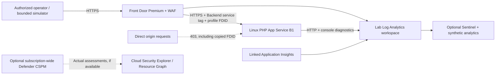

# PHP to Proof

**A Code-to-Cloud Defense Story.**

A disposable, defensive-only Azure investigation lab.

> **TRAINING ONLY.** Use an isolated, authorized Azure training subscription.
> Never use production resources, real sensitive data, or untrusted targets.
> This scaffold contains **no PHP2Shell exploit, command execution, actual outbound
> connection simulation, or real secret canary**. Process, egress, error, and
> canary examples are explicitly synthetic application logs. Azure resources,
> Defender CSPM, and Sentinel can incur charges.

> **Independent community project.** Not a Microsoft product, endorsement,
> assessment, or official security guide. See [DISCLAIMER.md](DISCLAIMER.md),
> [SECURITY.md](SECURITY.md), and the [license placeholder](LICENSE).

**PHP to Proof** is the public story name. `php2shell-cloud-defense-dojo`
remains the repository/package and technical scenario identifier. Child resource
names, ownership tags, health responses, and correlation keys remain stable.
PHP2Shell remains the advisory and hunting topic, not a claim of exploitation.

The **PUBLIC DEMO** badge describes the site's public availability, not a
production Azure environment. The deployment remains a dev-only training lab
with its existing safety gates and synthetic endpoints. Publishing the story
does not make the lab suitable for production workloads or real sensitive data.
The live site uses App Service's default (production) slot; `dev` is the lab's
logical environment, not a staging-slot indicator.

## Start the guided walkthrough

Open **Walkthrough** in the dashboard navigation, or visit `/walkthrough.php`
on the same deployed host. The [complete operator walkthrough](docs/walkthrough.md)
provides the terminal steps, before/after expectations, component comparison,
presenter prompts, troubleshooting, and cleanup.

The **GitHub** navigation link on both public pages opens the
[project repository](https://github.com/ninjapaw/php2shell-cloud-defense-dojo).

Like Pawton's guided story, each chapter compares what you can investigate
without additional Defender components and what supported, enabled components
can add. Unlike a live workload-detector demonstration, the PHP process,
outbound, error, and canary signals are synthetic. The guide does not promise
Defender alerts or show unqueried plan status as off. It is read-only, works
without JavaScript, and never enables a plan or runs a simulation.

The attack chapters follow fictional **Ghostpaw** through five moves: probe,
PHP error, attempted shell, attempted outbound contact, and a fabricated ledger.
Each pairs an actual captured synthetic event with a clearly labelled, conditional Defender
detection reference and a control that breaks the chain. The alert-results matrix
separates WAF logs, CSPM posture, workload detection, and optional Sentinel alerts.
Reference cards are not observed alerts or screenshots; the public story never
executes the attack.

### Authenticated operator console and recorded evidence

The separate [operator console](operator/README.md) uses Key Vault-backed admin
credentials, durable private audit/queue/session storage and the existing guarded
simulator. Its identity is separate from the unprivileged public PHP app. Only
bounded harmless/read-only actions are enabled by default; no arbitrary commands,
Defender toggles, teardown or automatic public publication are exposed.

The [official-response workflow](docs/response.md) completes GhostPaw's route:
detection, independent request-rule review, Prevention, response rule availability,
PHP patching, fixture closure and measured verification. The response overlay adds
`/response`, the public `/evidence/response` walkthrough, and a readable downloadable
Node.js script. Fixed mutation controls require an explicit feature opt-in,
fresh session-bound previews, exact confirmation, an active approved window and
separately authorized narrow permissions. They default off; installing code
does not grant permissions or extend the expired lab. Older deployments need the
response overlay before these routes are available.

Actual captures keep HTTP outcomes, UTC/run IDs, real WAF records, explicitly
synthetic app events, actual posture and independently observed workload alerts
separate. Raw records stay private. Public walkthrough snapshots require a
separate reviewed, redacted static publication. Comparing source logs available
without Defender to enabled Defender observations is not a claim that an existing
subscription's Defender plans were disabled.

Recorded deployment:

- [Administrator sign-in](https://p2p-proof1023c-operator-dacubycsdbh4etck.b01.azurefd.net/login)
- [Walkthrough and actual per-move logs](https://php2proof.ninjapaws.org/walkthrough.php#recorded)
- [Reviewed GhostPaw recording](https://php2proof.ninjapaws.org/evidence/92ad189c-9a88-4403-b773-52453963e4b8)
- [Administrator hunting scenarios and exact queries](https://p2p-proof1023c-operator-dacubycsdbh4etck.b01.azurefd.net/hunts)
- [Additional-value hunting case study](https://php2proof.ninjapaws.org/evidence/hunting)

This recording has five HTTP 200s, five ingested synthetic events, an actual
Detection-mode WAF match, four Healthy posture assessments and no returned
workload alerts. It is not a Defender-disabled experiment. Administrator
credentials are in the private `p2p-proof1023c-operator` Key Vault; see
[access and credentials](operator/README.md#access-and-credentials). The original
test deadline is **2026-10-24 18:45:04.967 UTC**. Expiry is not automatic resource
deletion.

## Learning objectives and evidence boundaries

Discover a PHP asset, understand exposure, review available attack paths, observe
bounded activity, correlate evidence, mitigate with WAF, remove training surfaces,
verify least privilege, and validate closure.

The live PHP dashboard makes the story tangible without installing a known
exploitable PHP build. **CVE-2026-109618 and CVE-2026-109619 identify the referenced
PHP advisories, not verified findings or claims about the deployed runtime.** Neither a
custom WAF marker hit nor a synthetic application event demonstrates exploitation
or protection against either CVE. A version-specific remediation claim would
require a verified advisory, affected-version evidence, and a separate patch test.

## Architecture and deployment boundaries



The required `resourceGroup` in [dev configuration](config/dev.json) selects
**`NP-PHPToProof-Dev-CentralUS`**, following the other projects'
`NP-<Workload>-<Environment>-<Region>` convention. This one group owns the
workload, WAF, global Front Door profile, logs, Application Insights, and optional
Sentinel. The CLI passes the same name into Bicep and uses it for every resource
ID, ownership check, and teardown confirmation; it is not derived from the suffix.

One suffix owns the configured group at a time. For another isolated run or a
different region, explicitly update the group name in JSON too. Changing that
setting selects a different target; it never renames, moves, or deletes existing
Azure resources. To operate an older `rg-p2s-SUFFIX-dev` lab, retain its exact name
in `resourceGroup` and its original suffix/location. The separate private
container lab keeps its own `rg-p2sc-SUFFIX-dev` group.

Shared Bicep comes from [Pawprint](https://github.com/ninjapaw/pawprint), with
content hashes and upstream MIT attribution included under [vendor/](vendor/).
Pawton's plan/doctor/deploy/repair/uninstall pattern informed the lifecycle.

The only optional subscription-wide resource is **Defender `CloudPosture`
Standard**, enabled only with `--enable-defender-cspm`. No other Defender plan is
enabled. The app has a system-assigned managed identity with **zero role grants**.
No passwords or certificates are generated, so no Key Vault is needed initially.
Any future generated secret must use Key Vault, not deployment outputs or files.

Front Door supplies HTTPS on its default domain and forwards over HTTPS.
The origin is network-restricted, not a private-endpoint architecture. The
separate public SCM publishing endpoint requires Entra bearer authentication;
both FTP and SCM basic credentials are disabled.

### Optional Cloudflare custom domain

Cloudflare remains authoritative; Azure Bicep owns Front Door routing, WAF, and
managed TLS. DNS uses Pawprint's shared, hash-checked
[reconciler](vendor/pawprint/scripts/cloudflare-dns.mjs), not a second provider
implementation. The default remains the Azure endpoint: no custom domain or
Cloudflare token is needed for the base lab.

After deploying the lab, choose an authorized **subdomain** in your Cloudflare
zone. Set `DOJO_CUSTOM_DOMAIN` (or the optional `customDomain` in
[dev configuration](config/dev.json)); `--custom-domain` is accepted only by
`plan`, `domain`, and `domain-check`.

The configured story hostname is **`php2proof.ninjapaws.org`** in the Cloudflare
zone **`ninjapaws.org`**. This setting declares the requested domain; it does not
claim DNS ownership, route/WAF association, or managed TLS is ready. The default
Azure endpoint remains available while the custom domain is activated.

```bash
export DOJO_CUSTOM_DOMAIN=php2proof.ninjapaws.org
export CLOUDFLARE_ZONE_NAME=ninjapaws.org
bash scripts/dojo.sh plan --environment dev
# Load CLOUDFLARE_API_TOKEN securely into the environment; never pass it as an argument.
# Alternatively, set CLOUDFLARE_ZONE_ID for this exact authorized zone.
bash scripts/dojo.sh domain --environment dev --yes
bash scripts/dojo.sh domain-check --environment dev
```

For manual Cloudflare entry, the record names below are relative to your zone:

| Type | Name | Target / content | Setting |
| --- | --- | --- | --- |
| CNAME | `php2proof` | This run's actual Front Door endpoint `properties.hostName`, ending in `azurefd.net` | DNS only; CNAME flattening off |
| TXT | `_dnsauth.php2proof` | The validation token generated by Azure for this custom domain | DNS only |

Use only the hostname in the CNAME target, without `https://` or a path. Do not
guess Azure's generated endpoint suffix or point DNS at the restricted
`azurewebsites.net` origin. DNS alone is insufficient: Azure ownership
validation, HTTPS route/WAF association, and managed TLS must also be ready.
If the public App Service/Front Door lab has not been deployed, there is no
CNAME target yet. The isolated affected-runtime container lab intentionally
has no public ingress and must not be used as the public site's DNS target.

The token needs **Zone Read + DNS Edit** for that zone only. `domain` is a
separate explicit write: it previews/creates the pending Front Door domain,
reconciles `_dnsauth` TXT and a DNS-only CNAME to the independently read
`azurefd.net` endpoint, checks public DNS and Azure ownership approval, then
previews/associates the domain with both HTTPS routing and WAF. It never creates
an alias to the PHP origin. Existing foreign or ambiguous records stop the
operation; each run's ownership includes its suffix. Azure/DNS propagation can
require rerunning `domain`; a pending certificate or hostname is not success.

`domain-check` is read-only and needs no Cloudflare token. Validation checks
managed TLS, exact Azure/WAF associations, app identity and marker behavior on
both hostnames. Repair/protection/remediation preserve pending or associated
domains, original expiry and fixed/Prevention state without DNS credentials.
The simulator still targets only the verified Azure endpoint, never an operator
URL override.

For the manual deployment workflow, set **dev** variables `LAB_CUSTOM_DOMAIN`
and `CLOUDFLARE_ZONE_NAME` or `CLOUDFLARE_ZONE_ID`, and a
`CLOUDFLARE_API_TOKEN` Environment secret. Select `domain` or `domain-check`;
regular deployment does not activate a configured domain automatically.
Remove this run's routing CNAME before releasing its Azure hostname. Uninstall
warns about retained DNS and deletes only the confirmed Azure resource group,
never shared records. See [operations](docs/operations.md).

## Billable categories (no invented prices)

| Category | Cost considerations |
| --- | --- |
| Front Door **Premium** | Base capacity, traffic, requests, WAF and any applicable transfer charges; not a free-tier lab |
| App Service Linux B1 | Provisioned capacity continues billing while idle |
| Log Analytics / Application Insights | Ingestion and retention; workspace is capped at 1 GB/day with 30-day retention |
| Optional Sentinel | Workspace security ingestion/analysis according to the selected pricing model |
| Optional Defender CSPM | Subscription-wide Standard plan; may affect resources outside this group |

The ingestion cap is **not a total budget or a guaranteed hard spending stop**.
Set a subscription budget and review the
[Azure pricing calculator](https://azure.microsoft.com/pricing/calculator/)
and your agreement before deploying. An expiry tag is a reminder, not automatic
teardown. Default lifetime is 24 hours, configurable from 1-72 hours.

## Optional isolated affected-runtime container

The original App Service lab remains non-exploitable and synthetic. A separate,
explicitly opted-in [container comparison](docs/container-lab.md) packages
digest-pinned PHP 8.4.26 and fixed 8.4.27 on a private AKS cluster with Defender
monitoring. It has no public ingress or exploit endpoint. This adds billable
compute, registry, networking, and telemetry; it is not enabled by the normal
lab deployment. Start with `npm run container:lab -- plan --suffix your1234`.

## Prerequisites

- Node.js 24.19+ within Node 24, npm, and Git.
- PHP 8.4 or 8.5 and ShellCheck for local lint/application tests.
- For Azure operations: Linux/macOS or **WSL2 with Linux Node**, Bash, `zip`,
  Azure CLI, and Bicep 0.48.1 (`az bicep install --version v0.48.1`).
- Native Windows supports the offline plan and Node/PHP tests. It deliberately
  does not invoke `az.cmd` through a shell; use WSL2 for cloud operations.
- An explicitly selected, enabled, authorized **AzureCloud** training subscription,
  supported Linux B1 region, registered providers, and reviewed deployment roles.
- For assessment queries: explicitly install the Azure CLI `resource-graph`
  extension. Scripts do not install extensions or register providers silently.

See [operations and OIDC setup](docs/operations.md) for provider registration,
scoped permissions, GitHub environment protection, and first-deployment setup.

## Quick start from a clean clone

```bash
git clone https://github.com/ninjapaw/php2shell-cloud-defense-dojo.git
cd php2shell-cloud-defense-dojo
npm ci
npm run lint
npm test
npm run vendor:check
npm run plan -- --environment dev --suffix demo1234
```

The plan is offline: no Azure login, calls, or writes. Choose your own globally
distinct 4-12 lowercase letter/digit suffix before deployment.

To preview the harmless dashboard locally:

```bash
php -S 127.0.0.1:8080 -t app
```

Open `http://127.0.0.1:8080`; stop the server with Ctrl+C. This is a local UI
preview, not cloud evidence, WAF validation, or Defender onboarding.
The guided story is at `http://127.0.0.1:8080/walkthrough.php`.

## Plan -> investigate -> close the loop

After reading the cost/permission boundaries and signing in:

```bash
az login
az account set --subscription '<authorized-training-subscription-uuid>'
export AZURE_SUBSCRIPTION_ID="$(az account show --query id -o tsv)"
export DOJO_SUFFIX=team42

bash scripts/dojo.sh plan --environment dev
bash scripts/dojo.sh doctor --environment dev
bash scripts/dojo.sh deploy --environment dev --yes
bash scripts/dojo.sh validate --environment dev
bash scripts/dojo.sh simulate --environment dev --yes
bash scripts/dojo.sh investigate --environment dev
```

`doctor` is read-only: tools, active subscription, cloud, provider registration,
Linux B1 region, runtime availability, effective permissions, and Bicep what-if.
It does not guarantee service capacity/quota, Azure Policy approval, or assessment
availability. Every deployment reruns doctor and checks the what-if boundary.
Deployment completion alone never counts as validated success.

For explicit billable additions, review the plan with the **same flags** first:

```bash
bash scripts/dojo.sh plan --environment dev --enable-defender-cspm --enable-sentinel
bash scripts/dojo.sh deploy --environment dev --yes --enable-defender-cspm --enable-sentinel
```

CSPM requires subscription pricing-write permission. `--enable-sentinel` installs
one disabled Informational training rule. Adding `--enable-analytics` enables
that labelled synthetic rule and requires Sentinel. Neither option invents
workload-protection telemetry or enables a simulation automatically.

### Validate WAF, then explicitly enforce Prevention

Save the simulator's UUID run ID and UTC timestamps. Review the real WAF records
and synthetic app logs using [the investigation guide](docs/investigation.md).
Once routing, the benign custom-rule match, and legitimate requests are reviewed:

```bash
bash scripts/dojo.sh protect --environment dev --yes
bash scripts/dojo.sh simulate --environment dev --yes
```

`protect` is the separate, explicit Detection-to-Prevention step. Only the benign
marker request should change from 200 to 403; other benign scenario requests
remain 200. Do **not** describe this as tested managed-rule CVE coverage.

### Remediate and repair

```bash
bash scripts/dojo.sh remediate --environment dev --yes
bash scripts/dojo.sh validate --environment dev
bash scripts/dojo.sh repair --environment dev --yes
```

Remediation re-deploys the supported PHP app in fixed state, returns 404 from all
training signal surfaces, enforces WAF Prevention, and verifies no runtime role
grants. It removes synthetic exposure, **not a verified vulnerable component**.
For a real vulnerable component, independently verify its advisory and deployed
patch level. There are no intentionally overbroad identity grants to remove.

Repair reapplies missing components, preserving fixed/Prevention state, original
expiry, and workspace opt-ins. It does not silently re-enable a missing Defender
pricing plan. Validation fails if a previously requested CSPM plan is no longer
Standard; restoring it requires a new explicit `--enable-defender-cspm`.

## Investigation guides

- **Full walkthrough:** [mission briefing, steps, with/without component matrix,
  expected evidence, presenter prompts, and troubleshooting](docs/walkthrough.md).
- **Defender CSPM:** [actual assessments, search terms, Cloud Security Explorer,
  sensitive data, permissions, exposure and attack-path pivots](docs/investigation.md#defender-cspm).
- **Azure WAF:** [managed-rule configuration, benign custom rule, run correlation,
  Detection/Prevention, and origin bypass tests](docs/investigation.md#azure-waf).
- **Microsoft Sentinel:** [hunting queries, synthetic rule and optional runtime
  telemetry](docs/investigation.md#microsoft-sentinel).
- **PHP to Proof hunting pack (PHP2Shell):** [all 10 asset-discovery methods, Hunts A-G,
  platform-specific queries and evidence evaluation](docs/hunting-pack.md),
  with a [machine-readable catalog](detections/catalog.json). The reviewed
  upstream revision is pinned; no estate queries, scans, telemetry onboarding
  or product-feed downloads run automatically.

### Expected versus optional evidence

| Expected after live validation | Optional; never promised |
| --- | --- |
| Working HTTPS PHP app and configured WAF | A particular PHP/CVE assessment |
| Direct origin 403, including copied FDID | Cloud Security Explorer discovery or an attack path |
| Marker 200 in Detection / 403 in Prevention | Sensitive-data findings (the lab has no real sensitive data) |
| Bounded, labelled synthetic application responses | Defender workload-protection alerts |
| Diagnostics configured for the exact lab workspace | MDE process/network records (not provided by this App Service design) |
| Fixed-state training surfaces return 404 | Immediate WAF/app log ingestion or Sentinel rule results |

Resource discovery, assessments, WAF propagation, log-table creation, ingestion,
and analytics evaluation are asynchronous. **No fixed completion time is
promised.** Validate has bounded retries after deployment; if propagation is not
ready, it fails explicitly and you rerun validation later. Empty results are not
proof of safety. Legitimate admin activity, retries, health probes and synthetic
markers can resemble detections; corroborate resource, identity and timestamps.
Optional screenshots should be your own observed evidence, not fabricated assets.

## GitHub Actions

All five workflows are **manual-only** and use the protected `dev` GitHub
Environment. Configure required reviewers, prevent self-approval, restrict
deployment branches, and protect workflow changes **before** running them.

Run `npm run github:check` first for read-only repository/environment readiness.
Missing or unreadable protection settings fail explicitly. All five workflows
run this check before Azure authentication or validation work; it never creates
an environment, grants permissions, reads secret values, or changes Azure.

- `validate.yml`: explicit **PHP 8.4 / 8.5** matrix, syntax, ShellCheck, tests,
  audit, Bicep build/lint and compiled infrastructure safety assertions; no
  Azure authentication.
- `deploy.yml`: offline plan or read-only doctor; deploy/repair/protect include
  what-if and live post-deployment validation.
- `simulate.yml`: approved bounded benign requests using a read identity.
- `remediate.yml`: fixed-state deployment and closure validation.
- `teardown.yml`: exact typed scenario-group confirmation.

Actions are pinned to commit SHAs, and runners use **Ubuntu 24.04** rather than
the moving `ubuntu-latest` label. Mutating workflows and simulation share one
non-cancelling concurrency group. OIDC is used instead of client secrets; no Azure
credential caches, tokens, or deployment outputs are uploaded. See
[the setup guide](docs/operations.md#github-oidc-and-environment-approvals).

## Complete teardown

Keep the same JSON `resourceGroup`, subscription, region, and suffix. Review the
offline plan and type that exact group name; `--yes` cannot bypass this. For the
checked-in configuration:

```bash
bash scripts/dojo.sh uninstall --environment dev \
  --confirm-resource-group "NP-PHPToProof-Dev-CentralUS"
```

The command checks exact resource ID and ownership tags, deletes **only that
resource group**, waits, and verifies its absence. It cannot delete at
subscription/tenant scope or accept an arbitrary resource-group override.

**Defender CSPM subscription pricing remains unchanged.** Separately review
Standard-plan billing, budgets, any manually created OIDC applications/federated
credentials and scoped role assignments. Do not disable shared security plans or
delete another project's identity. See the
[full teardown checklist](docs/operations.md#teardown-and-residual-items).

## Development

Tests run the real local PHP app and compile all **27 KQL queries** with the
official Kusto language service against platform-specific schema fixtures.
The six lab queries also cover empty/app-only schemas; the 21 estate queries
check explicit errors for each missing required table and exact output columns.
`npm run evaluate` checks all 10 discovery methods, 10 hunt items and the mapping
to all 16 upstream query files, with live/manual evidence explicitly **not run**.
These are offline syntax/type/coverage checks, not executed query thresholds or
assertions of live telemetry or detection efficacy.
The manual validation workflow explicitly installs both supported PHP branches
with a pinned setup action; it does not depend on the runner's default PHP.
It also runs pinned actionlint and Bicep 0.48.1. Hosted workflow execution still
requires the protected `dev` environment to be configured and approved.
Git enforces LF for all text sources, including JSON, CSS, INI and Markdown,
so a native Windows checkout uses the same line-ending contract as Linux CI.

```bash
npm run lint
npm test
npm run evaluate
npm run vendor:check
az bicep build --file infra/main.bicep --outfile /tmp/php2shell-arm.json
npm run infra:check -- /tmp/php2shell-arm.json
```

To update shared infrastructure, change Pawprint first, then:

```bash
node scripts/sync-pawprint.mjs --source ../pawprint
node scripts/check-vendor.mjs --source ../pawprint
```

A sibling checkout is **not** needed to build/test a clean clone. The vendored
snapshot is content-hashed; its base commit is not a claim that pending shared
changes are already published. Publish both repositories together and re-sync
before releasing. Review [the project instructions](.github/copilot-instructions.md).
